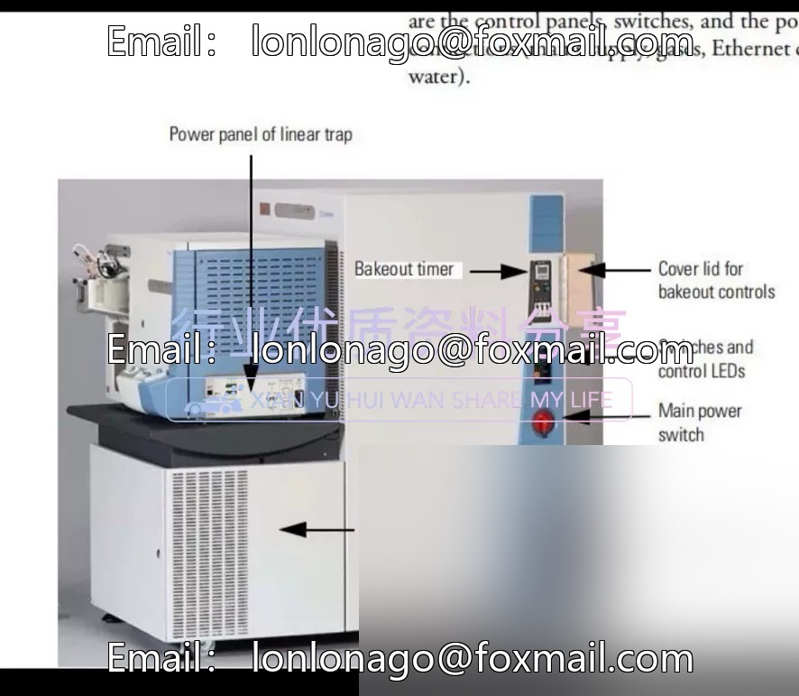
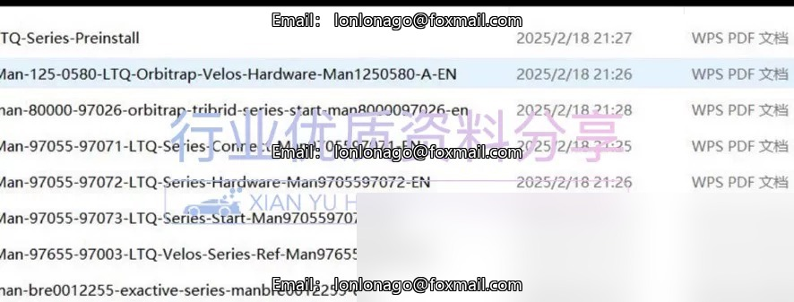
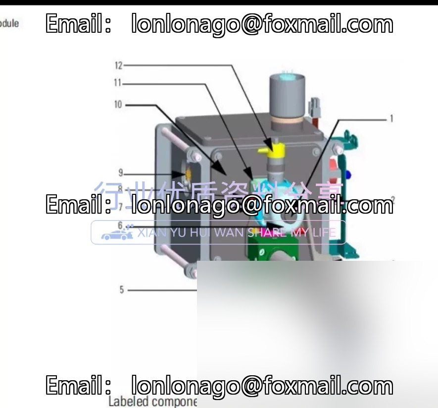
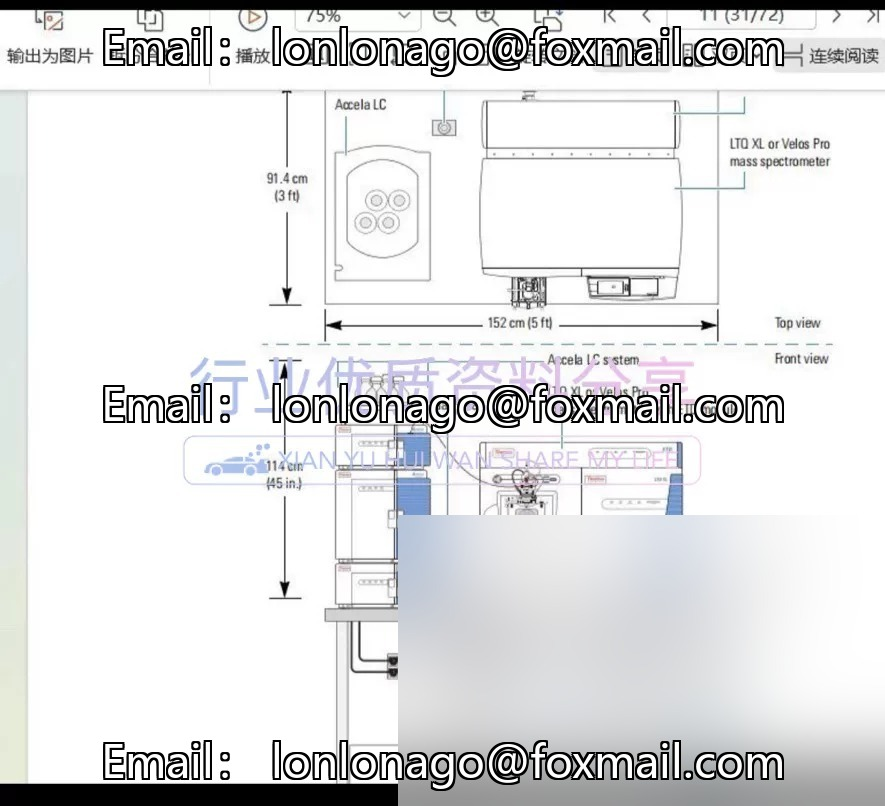
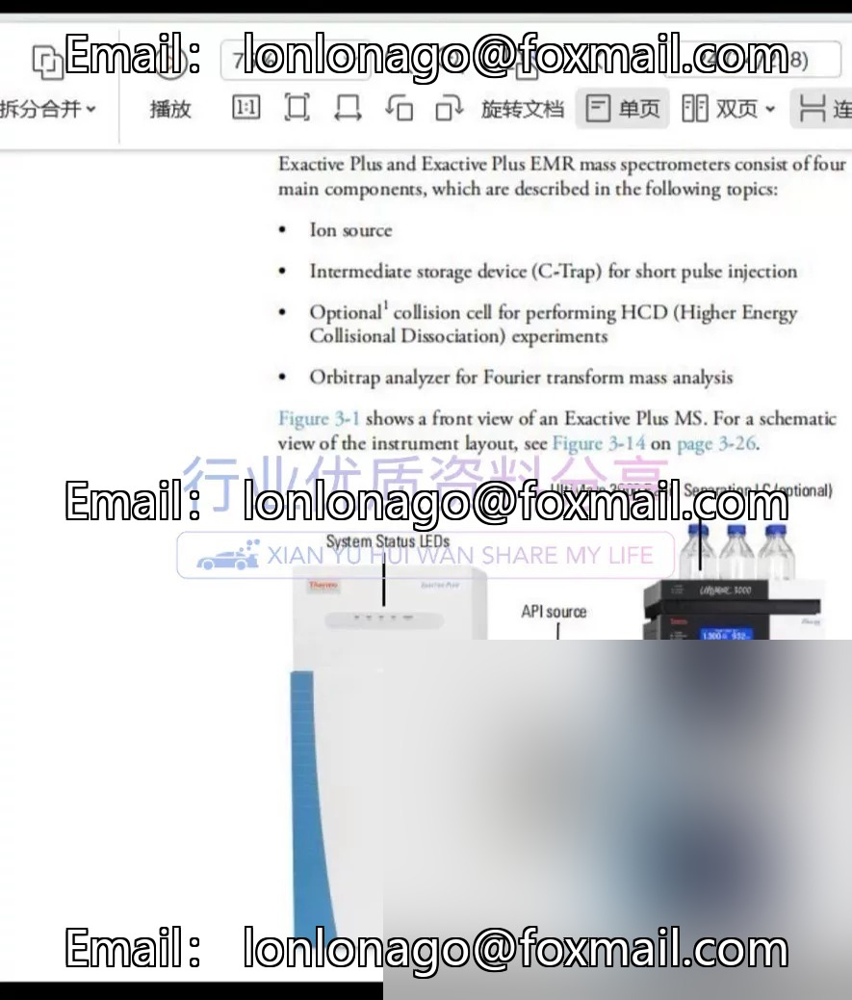
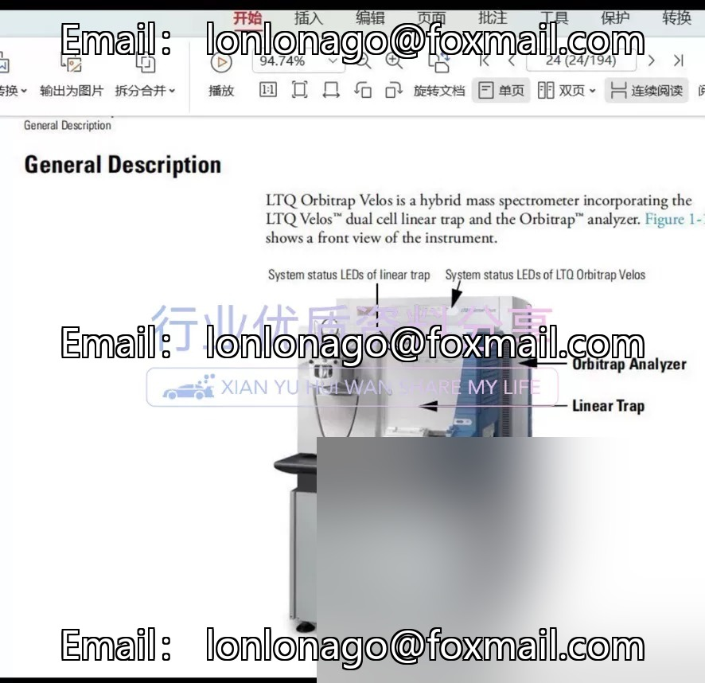
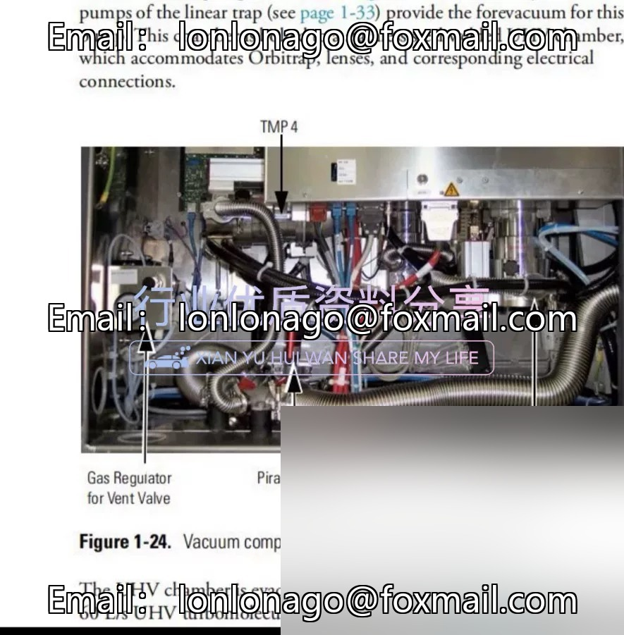

# Thermo Fisher LTQ series ion mass spectrometers - multiple manual and documentation materials, full set including hardware manuals

## Body

Sometech LTQ series ion mass spectrometer multi-handbooks: full set, including hardware manual, operation manual, and introduction guide! Packed price. Each copy is hundreds of pages, very detailed!

Capture and send the electronic original directly! The following images include screenshots of the file portion. Please confirm before placing the order! Due to the replicable nature of electronic documentation Therefore, are allowed after purchase! Thanks for understanding!

The materials cover LC and LTQ series ion mass spectrometry manuals, including hardware, operation guides and beginner guides; multiple manuals and e-document formats are available with detailed content.

<!-- AI_ENRICHED -->

## Images

## Payment

Here is a pay link on Stripe ( https://buy.stripe.com/3cs8yP7sY87d0vu9AB ). Please contact me lonlonago@foxmail.com after funding $89, and I will send you a complete data files , thank you!

